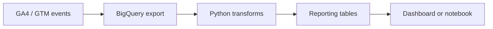
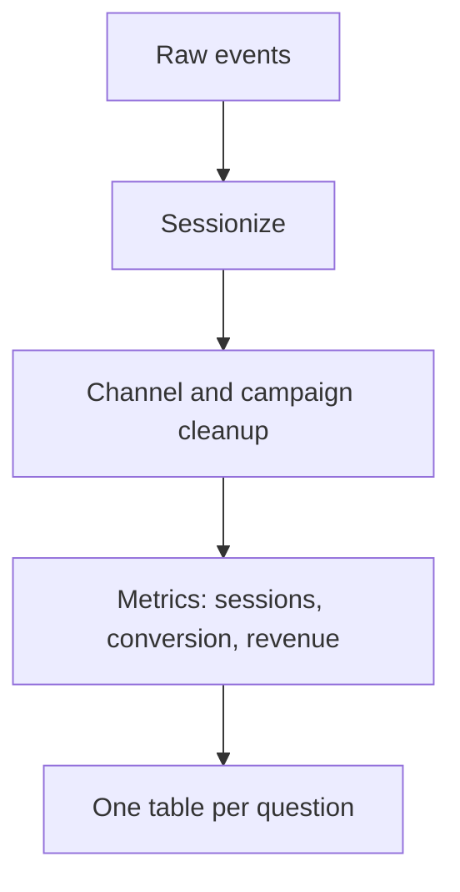

# GA4 and GTM analytics

Web analytics events are not a report. This project takes Google Analytics 4 and Tag Manager data, including the BigQuery export, and turns it into tables a sales or product review can use without re-deriving the same filters every Monday.



## Why a pipeline

The GA4 interface is fine for a weekly glance and painful for a question that joins campaigns, landing pages, and purchases. The export is the source of truth. Transforms name the grain (session, user, or event), drop the duplicated hits, and land a table whose columns do not change when someone renames a tag.



## Run it

```bash
python -m venv .venv && source .venv/bin/activate
pip install -r requirements.txt
```

Credentials for BigQuery stay outside the repo. The scripts expect an export that already exists. Read the module docstrings for the table names they write.

## What this signals

Analytics engineering: measurement you can rerun, instead of a screenshot of the GA4 UI.
